# Giga
거위 2족보행로봇

**MuJoCo 2족 보행 로봇 시뮬레이터 + ROS2 제어 + 강화학습** (교육용 baseline, 패키지 이름 `biped_sim`)

<table>
<tr>
<td align="center">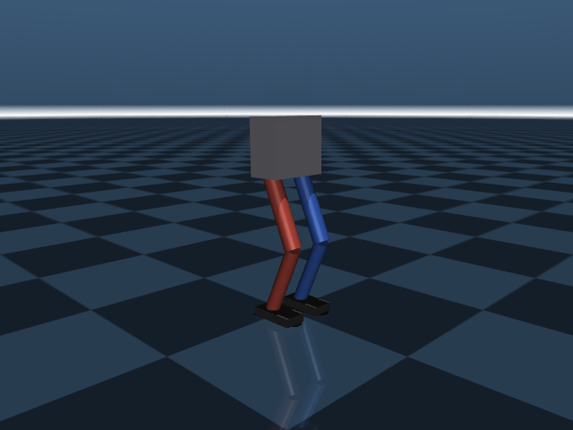<br>MuJoCo에서 서 있는 2족 로봇 (5단계)</td>
<td align="center">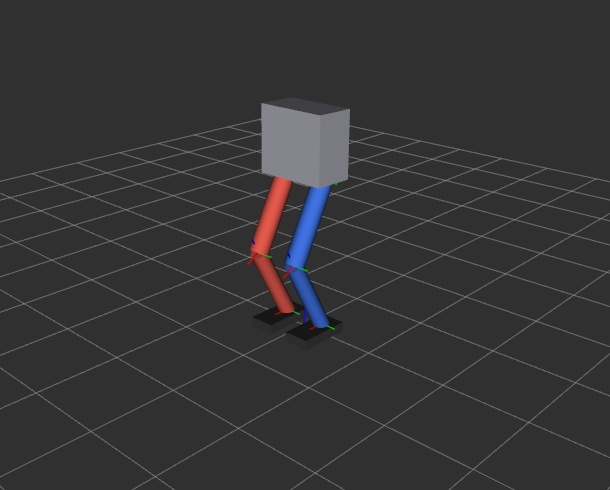<br>ROS2 + RViz로 조종 (7단계)</td>
</tr>
<tr>
<td align="center">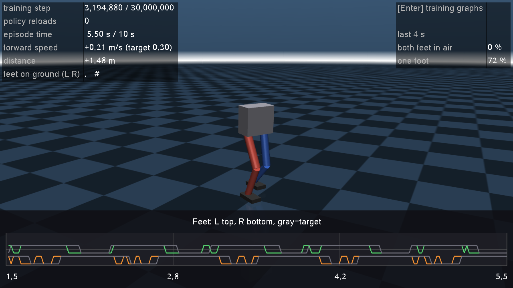<br>GPU 강화학습으로 걷기를 배우는 중 (10단계)</td>
<td align="center">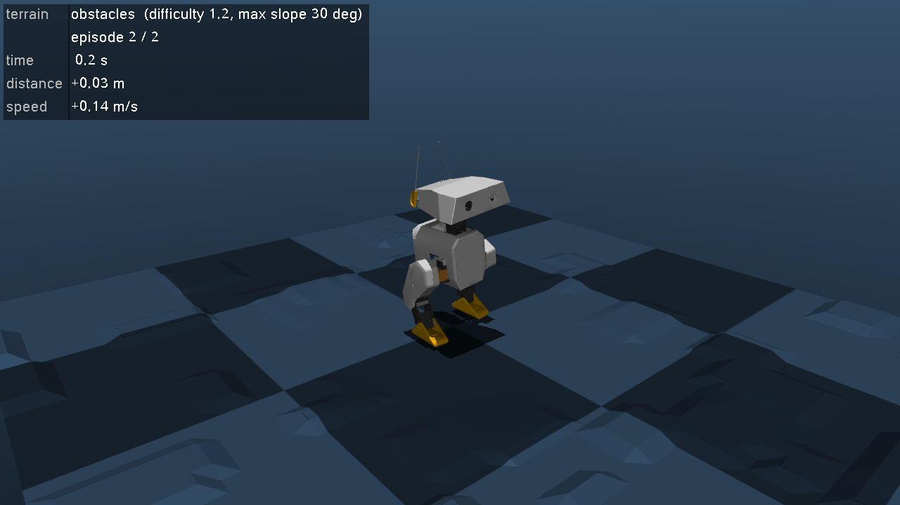<br>오픈소스 오리 로봇이 장애물 지형을 걷는 모습 (13단계)</td>
</tr>
</table>

환경: Ubuntu 22.04 + ROS2 Humble + Python 3.10 · 시뮬레이터: MuJoCo 3.15.0 · GPU 학습: NVIDIA GPU (GTX 1650 4 GB에서 확인)

---

## 이 저장소로 할 수 있는 것

아래 순서대로 하나씩 해 보면 "시뮬레이터에 로봇을 띄우기"부터 "실물 로봇에 올릴 걷기 정책 만들기"까지 따라갈 수 있습니다.

| 단계 | 하는 것 | 이렇게 됩니다 |
|---|---|---|
| 1~5 | **MuJoCo**로 2족 로봇 시뮬레이션: 서 있기, 밀면 넘어지기 | 로봇이 무릎을 살짝 굽히고 서 있음 |
| 6~7 | **ROS2**로 조종: 토픽으로 관절 명령, RViz로 보기 | MuJoCo 창과 RViz 창의 로봇이 똑같이 앉았다 일어섬 |
| 8 | 자동 점검 (`python -m pytest`) | 시뮬레이션·튜토리얼·ROS2 연동이 모두 정상인지 30초 만에 확인 |
| 9 | **강화학습 첫 예제**: 밀려도 넘어지지 않기 (CPU 4분) | 학습한 로봇이 스스로 발을 딛어 버팀 |
| 10 | **GPU로 걷기 학습** (20~35분) + 걸음 분석·다듬기 | 절뚝이던 걸음을 진단하고 고침 |
| 11~12 | **남이 만든 오픈소스 로봇**(오리 모양 Open Duck Mini) 불러오기와 걷기 | 받은 URDF의 문제를 찾아 보완하고 걷게 함 |
| 13 | **울퉁불퉁한 지형**: 언덕·경사로·장애물 | 지형에서 연습한 오리는 험한 지형도 걸음 |
| 14 | **실물 기준 점검**: 서보 토크·속도 한계를 계산하고 맞추기 | 실물 서보가 감당할 수 있는 걸음으로 |
| 15 | **자동 평가와 자율 학습**: 학습 → 평가 → 다음 실험을 자동으로 | 가장 잘 걷는 정책(챔피언)이 계속 갱신됨 |
| 16 | **명령 따라 걷기**: 방향키로 앞뒤·옆·돌기 조종 | 오리가 키보드 명령대로 걷고 돎 |
| 17 | **ROS2로 정책 돌리기 (sim-to-sim)**: 센서 토픽 → 정책 노드 → 관절 명령 | 실물과 같은 구조로 오리를 조종 |

### 어디서부터 시작할까

| 하고 싶은 것 | 필요한 것 | 할 단계 |
|---|---|---|
| MuJoCo 시뮬레이션을 처음 해 본다 | Ubuntu 22.04 PC | 0 → 5 |
| ROS2로 로봇을 조종해 본다 | 위 + ROS2 Humble (2단계에서 설치) | 0 → 7 |
| 강화학습을 맛본다 | 위 (GPU 없어도 됨) | 0 → 5, 9 |
| 로봇이 걷기를 배우게 한다 | **NVIDIA GPU** | 0 → 5, 10 |
| 오리 로봇·지형·실물 기준·명령 조종까지 | NVIDIA GPU + 인터넷 (로봇 파일 19 MB) | 0 → 5, 10 → 16 |
| 학습한 오리를 ROS2로 조종 (GPU 없이도) | 위 + ROS2 (2단계) + 오리 로봇 파일 (11단계) | 0 → 7, 11, 17 |

처음이면 위에서부터 순서대로 하세요. 각 단계 끝의 **"✅ 확인"** 과 같은 결과가 나오면 다음으로 넘어가면 됩니다.

---

## 처음 시작하기 — 아무것도 몰라도 그대로 따라 하면 됩니다

명령을 **순서대로 하나씩** 복사해서 터미널에 붙여 넣으세요.
처음 한 번은 ROS2 설치 때문에 인터넷 속도에 따라 수십 분이 걸릴 수 있습니다. 두 번째부터는 4단계(환경 켜기)만 하면 됩니다.

### 0단계. 준비물과 기본 용어

- **Ubuntu 22.04** 가 설치된 PC (다른 버전은 안 됩니다 — ROS2 Humble이 22.04 전용)
- 인터넷 연결, 관리자(sudo) 비밀번호, 디스크 여유 공간 약 5 GB (GPU 학습까지 하면 약 8 GB)

| 용어 | 뜻 |
|---|---|
| 터미널 | 명령을 입력하는 창. 키보드 `Ctrl` + `Alt` + `T` 로 열립니다 |
| 붙여넣기 | 터미널에서는 `Ctrl` + `Shift` + `V` (그냥 `Ctrl` + `V`는 안 됨) |
| `#` 뒤의 글 | 설명(주석)입니다. 같이 붙여 넣어도 무시되니 괜찮습니다 |
| `Ctrl` + `C` | 터미널에서 **실행 중인 프로그램을 멈춤** (복사가 아님) |
| 정책 (policy) | 강화학습으로 배운 "로봇의 뇌". 센서 값을 받아 관절 명령을 내는 신경망 (`.pkl` 파일) |

### 1단계. 저장소 받기 (처음 한 번)

```bash
sudo apt update && sudo apt install -y git     # git 설치 (이미 있으면 그냥 넘어감)
cd ~                                           # 홈 폴더로 이동
git clone https://github.com/joshualikaist/Giga.git
cd Giga
```

✅ 확인: `ls` 를 입력하면 `README.md  docs  scripts  tutorials ...` 가 보입니다.

### 2단계. ROS2 등 시스템 프로그램 설치 (처음 한 번, 관리자 비밀번호 필요)

```bash
bash scripts/install_system_deps.sh --dry-run   # 무엇을 설치할지 미리 보기만 함 (아무것도 안 바뀜)
bash scripts/install_system_deps.sh             # 실제 설치: 'y' 입력 → 비밀번호 입력
```

- ROS2가 없는 PC면 [공식 설치 절차](https://docs.ros.org/en/humble/Installation/Ubuntu-Install-Debs.html)대로 ROS2 Humble부터 설치합니다 (시스템 업데이트 포함이라 오래 걸림).
- ROS2가 이미 있으면 이 프로젝트에 필요한데 빠진 것만 설치합니다.

✅ 확인: 마지막 줄에 `완료! 다음 단계:  bash scripts/setup_env.sh` 또는 `필요한 패키지가 모두 설치되어 있습니다. 할 일이 없습니다. ✅`

### 3단계. 파이썬 환경 설치 (처음 한 번)

> 터미널 줄 맨 앞에 `(base)` 같은 글자가 보이면 conda가 켜져 있는 것입니다. 먼저 `conda deactivate` 를 입력해 끄세요 (글자가 사라질 때까지).

```bash
bash scripts/setup_env.sh
```

MuJoCo 등을 프로젝트 전용 폴더(`.venv`)에 설치하고, 마지막에 환경 점검 결과를 보여 줍니다.

✅ 확인: 끝부분에 `결과: FAIL 0개` (WARN은 있어도 괜찮습니다)

### 4단계. 환경 켜기 — ⚠ 새 터미널을 열 때마다 매번

```bash
cd ~/Giga
source scripts/activate.sh
```

✅ 확인:
```
[biped_sim] 환경 활성화 완료
  python : /home/(사용자이름)/Giga/.venv/bin/python
  ROS    : humble (ROS_DOMAIN_ID=27)
  ros2_ws: ros2_ws 아직 빌드 안 됨 (bash scripts/build_ros.sh)    ← 6단계 후에는 'ros2_ws 로드됨'
```

> 이걸 안 하면 `No module named 'mujoco'`, `ros2: command not found` 같은 오류가 납니다.
> `bash scripts/activate.sh` 가 아니라 반드시 **`source`** 입니다.

### 5단계. 첫 시뮬레이션 — MuJoCo만 (ROS 없이)

```bash
python tutorials/t01_hello_mujoco.py      # 상자와 공이 바닥에 떨어지는 창이 뜸
```

창을 닫거나 터미널에서 `Ctrl` + `C` 로 끝냅니다. 다음은 2족 로봇:

```bash
python tutorials/t06_biped_stand.py       # 로봇이 바닥에 서 있음
```


- 마우스: 왼쪽 드래그 = 회전, 오른쪽 드래그 = 이동, 휠 = 확대
- **로봇 밀어 보기**: 몸통을 더블클릭 → `Ctrl` 을 누른 채 마우스 오른쪽 버튼으로 드래그
- 튜토리얼은 t01~t06 순서로 하나씩 해 보세요 → [tutorials/README.md](tutorials/README.md)

✅ 확인: 위 그림처럼 로봇이 무릎을 살짝 굽히고 서 있으면 성공

### 6단계. ROS2 패키지 빌드 (처음 한 번 + `git pull`로 새 코드를 받았을 때)

```bash
bash scripts/build_ros.sh
source scripts/activate.sh                # 빌드 결과를 지금 터미널에 반영
```

✅ 확인: `Summary: 2 packages finished`, 그리고 activate 출력에 `ros2_ws: ros2_ws 로드됨`

> `colcon build` 를 직접 쓰지 마세요. 꼭 `bash scripts/build_ros.sh` 로 빌드해야 합니다 (이유: [docs/05 §2](docs/05_ros2_bridge_plan.md)).

### 7단계. ROS2로 실행하기

**① 로봇 모델 보기** — 물리 없이 생김새만

```bash
ros2 launch giga_description display.launch.py
```

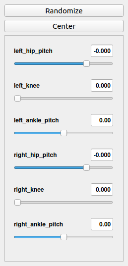 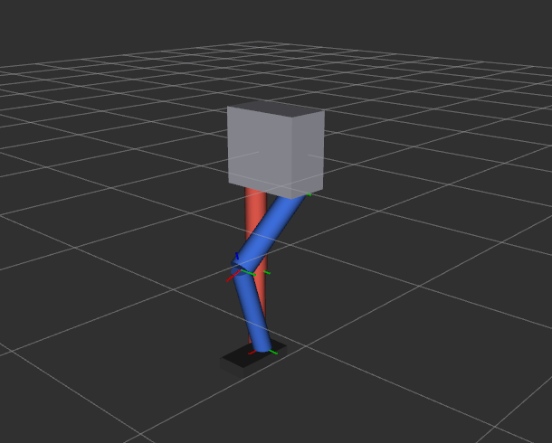

슬라이더 창(왼쪽)을 움직이면 RViz(오른쪽)의 다리가 따라 움직입니다. `Ctrl` + `C` 로 종료.

**② 시뮬레이터 + 제어기** — 로봇이 앉았다 일어서기를 반복

```bash
ros2 launch giga_sim_ros sim.launch.py controller:=squat
```


MuJoCo 창과 RViz 창이 함께 뜨고, 두 창의 로봇이 똑같이 움직이면 성공입니다.
`controller:=stand` 로 바꾸면 가만히 서 있고, `controller:=` 부분을 빼면 제어기 없이 시뮬레이터만 켭니다.
종료: 터미널에서 `Ctrl` + `C` 또는 MuJoCo 창 닫기 (모든 프로그램이 함께 꺼짐).

**③ 터미널에서 직접 조종** — 터미널 2개 사용

```bash
# 터미널 1 (cd ~/Giga && source scripts/activate.sh 먼저)
ros2 run giga_sim_ros sim_node --ros-args -p fixed_base:=true      # 공중에 매달린 로봇
```

```bash
# 터미널 2 (여기서도 cd ~/Giga && source scripts/activate.sh 먼저)
ros2 topic pub --once /joint_commands sensor_msgs/msg/JointState "{name: [left_knee], position: [1.5]}"
```

✅ 확인: 명령을 보낼 때마다 MuJoCo 창에서 **왼쪽 무릎만** 굽혀지면 성공

각 명령에서 내부적으로 무슨 일이 일어나는지, 더 많은 실습은 → **[docs/06 ROS2 실행 가이드](docs/06_ros2_hands_on.md)**

### 8단계. (선택) 전부 잘 되는지 자동 점검

```bash
python -m pytest
```

창 없이 약 1분 동안 시뮬레이션·튜토리얼·ROS2 연동을 모두 시험합니다.
(`pytest`만 치면 "명령을 찾을 수 없음"이 나올 수 있습니다: 시스템에 이미 깔린 pytest를 쓰느라 `pytest` 명령이 따로 안 생겨서. `python -m pytest`는 항상 됩니다.)

✅ 확인: 마지막 줄에 `failed`가 없으면 성공입니다 (처음엔 `38 passed, 36 skipped`).
`skipped`는 아직 설치하지 않은 선택 항목의 테스트입니다: 9단계 학습 패키지(5개), 10단계 GPU 학습 환경(20개, 그 환경에서
`python -m pytest tests/test_walk_mjx.py`로 따로 실행), 11단계 오리 로봇 파일(11개). 설치하면 그만큼 `passed`로 바뀝니다.

---

## 강화학습

### 9단계. (선택) 강화학습 첫 예제 — 로봇이 스스로 균형 잡는 법을 배우기

PD 제어만으로는 몸통을 30 N으로 밀면 넘어집니다. 강화학습으로 정책을 4분쯤 학습시키면 40 N까지 버티고,
아무도 가르쳐 주지 않은 **발 딛기**를 스스로 찾아냅니다.

```bash
bash scripts/setup_learning.sh                                       # 학습 패키지 설치 (처음 한 번, 수 분)
python learning/evaluate_balance.py --pretrained --view --push 40    # 학습 없이 바로: 미리 학습된 정책이 40 N을 버팀
python learning/evaluate_balance.py --view --push 40 --baseline      # 같은 상황에서 PD만 쓰면 넘어짐
python learning/train_balance.py                                     # 직접 학습 (CPU 약 4분)
```

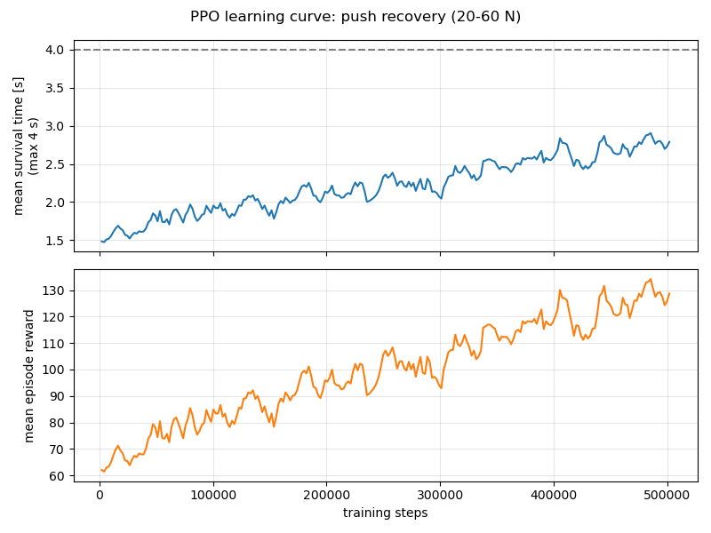

*학습 곡선: 학습할수록 밀려도 버티는 시간(위)과 보상(아래)이 오릅니다.*

✅ 확인: `train_balance.py`가 끝나면 학습 전/후 비교표가 나옵니다 (이 PC 실측)

```
밀기 세기   PD만(학습 전)   학습한 정책
   20 N     6/6 버팀        6/6 버팀
   30 N     0/6 버팀        6/6 버팀
   40 N     0/6 버팀        5/6 버팀
   50 N     0/6 버팀        4/6 버팀
   60 N     0/6 버팀        0/6 버팀
```

강화학습 개념, 과제 설계, 결과 해석, CPU vs GPU 실측, 직접 해 볼 과제 → **[docs/07 강화학습 첫 예제](docs/07_learning.md)**

#### 학습 그래프 보기 (TensorBoard)

TensorBoard는 학습 기록(`output/learning/` 안의 파일)을 그래프로 보여 주는 프로그램입니다.
인터넷 사이트가 아니라 **내 컴퓨터에서 직접 켜는 웹페이지**입니다. 켜 두면 학습 중에도 그래프가 계속 갱신됩니다.

```bash
# 새 터미널을 열고
cd ~/Giga
source scripts/activate.sh
tensorboard --logdir output/learning
# → "TensorBoard 2.21.0 at http://localhost:6006/" 가 나오면 성공. 이 터미널은 닫지 말고 그대로 둡니다.
```

1. 같은 컴퓨터의 웹 브라우저(Chrome, Firefox 등) 주소창에 **http://localhost:6006** 을 입력합니다.
2. 위쪽 **SCALARS** 탭에 그래프가 나옵니다. 왼쪽 **Runs**에서 보고 싶은 학습에 체크합니다. 이름은 `날짜_시각_내용` (예: `261008_140644_walk_scratch`)이라 시간순으로 정렬됩니다.
3. 위쪽 검색칸에 `reward` 를 입력하면 보상 그래프만 모아서 볼 수 있습니다.
4. 걷기 학습(10단계~)이 끝난 뒤의 **자동 평가 보고서**는 **TEXT** 탭에 있습니다 (15단계).
5. 끄려면 TensorBoard 터미널에서 `Ctrl+C`를 누릅니다.

### 10단계. (선택, NVIDIA GPU 필요) GPU로 걷기 학습

시뮬레이션 자체를 GPU에서 1024개 동시에 돌려(MuJoCo MJX + Brax PPO) **걷기**를 학습합니다. CPU 학습보다 약 13배 빠릅니다.
ROS2 환경과 섞이지 않도록 **별도 가상환경(`.venv-mjx`)** 을 씁니다.

```bash
bash scripts/setup_gpu_learning.sh            # GPU 학습 환경 설치 (처음 한 번, 약 3 GB)
source scripts/activate_gpu.sh                # GPU 학습 환경 켜기 (ROS를 켜지 않은 새 터미널에서)
python learning/train_walk_gpu.py --watch     # 약 3,200만 스텝, 20~35분 (처음 3~4분은 컴파일) + 학습 화면
python learning/play_walk.py --view           # 학습이 끝난 뒤 걸음 보기
```

> `source scripts/activate_gpu.sh`를 잊고 ROS용 터미널(`.venv`)에서 실행해도, 보행 스크립트가 알아서 GPU 학습 환경으로 다시 실행합니다.

`--watch`를 붙이면 **학습 화면**(MuJoCo 창)이 함께 열립니다. 창을 한 번 클릭한 뒤 **Enter 키**로 두 화면을 오갑니다.

<table>
<tr>
<td align="center">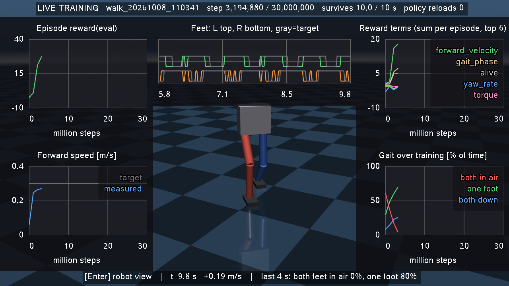<br>학습 현황 (처음 화면): 양옆에 학습 그래프, 가운데에 발 접촉과 지금 정책으로 걷는 로봇</td>
<td align="center"><br>로봇 보기 (Enter): 아래는 발 접촉 그래프 (파랑 = 왼발, 빨강 = 오른발, 높으면 딛고 있음)</td>
</tr>
</table>

- 로봇은 학습이 정책을 저장할 때마다(약 40초~2분) 새로 배운 정책으로 바뀝니다. 첫 정책이 나오기 전(3~4분)에는 제자리에 서 있습니다.
- 발 접촉 그래프에서 좌우가 번갈아 높으면 걷기, 둘이 함께 낮으면 두 발이 다 떠 있는 뛰기입니다.
- 학습 화면은 학습과 별도 프로그램이라 **창을 닫아도 학습은 계속**되고, 학습이 끝나도 창은 마지막 정책을 계속 재생합니다 (위 글자가 `TRAINING FINISHED`로 바뀜).

✅ 확인: 학습 출력에서 `버틴 시간 10.00 s / 10 s`, `앞으로 속도 +0.30 m/s`, `두 발 공중 0%` 근처가 되면 넘어지지 않고 목표 속도로 걷는 것입니다.

> 요청한 스텝(기본 3,000만)보다 조금 더 돕니다 (Brax가 평가 간격마다 학습 단위로 올림). 시작할 때 실제 스텝 수를 알려 줍니다.

#### 걸음 분석하고 다듬기

학습이 끝나면 걸음을 영상·사진·그래프로 확인하고, 문제가 있으면 보상을 바꿔 **그 정책에서 이어서** 학습합니다.

```bash
python learning/analyze_gait.py --run output/learning/<YYMMDD_HHMMSS>_walk   # 저장된 정책을 모두 비교 → 가장 좋은 걸음을 영상까지 분석
# → output/gait/<실행>_<스텝>/ 에 walk.mp4(영상), walk_slow.mp4(4배 느리게), filmstrip.png(한 걸음 연속 사진),
#   gait.png(관절 각도 좌우 비교 그래프), 터미널에 좌우 대칭 수치와 '절뚝임 점수'
python learning/train_walk_gpu.py --init-from <위에서 고른 정책.pkl> \
    --reward heading=-5 --steps 10000000 --name walk_heading --watch   # 예: 방향 유지를 더 강하게 이어서 다듬기 (약 12분)
```

| 처음 배운 걸음: 절뚝임 (절뚝임 점수 40.6 %) | 보상을 고쳐 다듬은 걸음 (2.1 %) |
|---|---|
| 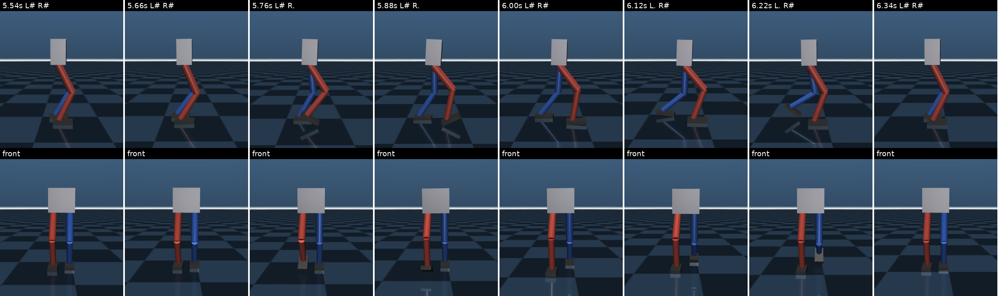 | 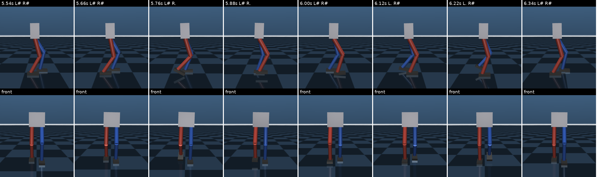 |

절뚝이는 걸음을 이렇게 진단하고 고친 실제 과정 → **[docs/08 §6](docs/08_gpu_walking.md#6-걸음-다듬기--보고-진단하고-보상을-바꿔-이어서-학습)**,
과제 설계·보상 항목·결과 분석 → **[docs/08 GPU 보행 학습](docs/08_gpu_walking.md)**

---

## 오픈소스 로봇 — 오리 Open Duck Mini v2

여기부터는 직접 만든 로봇이 아니라 **인터넷에서 받은 실제 로봇**(디즈니 BD-X 드로이드를 본뜬 오픈소스 프로젝트, 키 약 42 cm)을 다룹니다.
실물이 있는 로봇이라, 시뮬레이션에서 배운 걸음을 **실물에 올릴 수 있는지**까지 따져 봅니다. 10단계의 GPU 환경이 필요합니다.

### 11단계. 오리 로봇 불러오기

인터넷에서 받은 URDF를 그대로 시뮬레이터에 넣으면 생기는 문제(메시 경로, 토크 한계, 가짜 접촉 등)를 하나씩 확인하고,
받은 파일은 고치지 않고 불러올 때 보완합니다.

```bash
source scripts/activate.sh
bash scripts/get_open_duck.sh                   # URDF + 메시 + 라이선스 받기 (처음 한 번, 약 19 MB)
python tutorials/t07_open_duck.py --headless    # 문제 확인 → 보완 → 좌우 관절 부호 → 서 있기 검증
python tutorials/t07_open_duck.py               # 뷰어: PD로 서 있는 오리 (Ctrl+오른쪽 드래그로 밀어 보기)
```

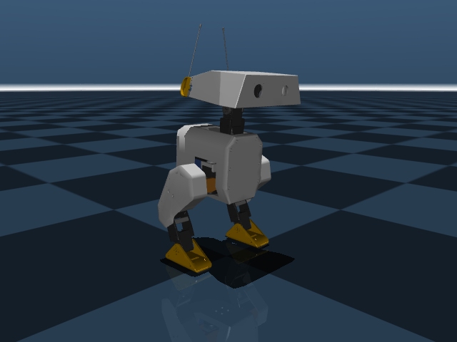

✅ 확인: 마지막에 `발 하중 ... = 무게(20.22 N)의 1.000배`, `서 있음 ✅`

오픈소스 URDF를 받을 때의 점검표와 확인 과정 → **[docs/09 §1~5](docs/09_open_source_robot.md)**

### 12단계. 오리 걷기 학습

```bash
source scripts/activate_gpu.sh
python learning/train_walk_gpu.py --robot open_duck_mini --watch            # 평지에서 걷기 (창을 띄우면 약 1시간 20분)
```

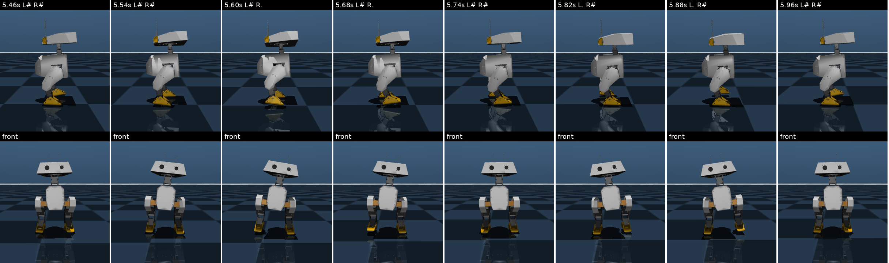

*처음 배운 오리 걸음 (위: 옆에서, 아래: 앞에서). 오리처럼 좌우로 뒤뚱거리며 걷습니다.*

> 오리는 CAD 메시가 무거워(삼각형 37만 개) `--watch` 창을 띄우면 학습이 약 2배 느려집니다. 창을 닫아도 학습은 계속되고,
> 다시 보려면 `python learning/play_walk.py --live --params <실행 폴더>/params.pkl`.

두 가지 학습 방식(보상만 / 참고 동작 따라 하기) 비교 → **[docs/09 §6](docs/09_open_source_robot.md)**

### 13단계. 울퉁불퉁한 지형 — 언덕, 불규칙한 경사로, 장애물

평지에서만 배운 오리는 험한 지형에서 10번 중 2~4번만 버팁니다. **지형에서 연습**시키면 달라집니다.

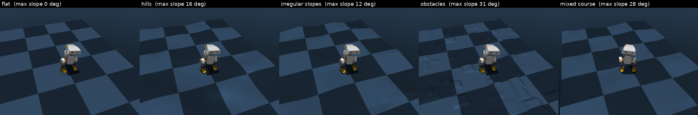

*시험 지형 5종 (험한 정도 1.5): 평지, 언덕, 불규칙한 경사로, 장애물, 섞인 코스. 에피소드마다 새로 만들어집니다.*

```bash
python learning/terrain_trial.py --params <정책.pkl> --difficulty 1.0          # MuJoCo 화면: 지형마다 새 지형으로 걸려 보기
python learning/train_walk_gpu.py --robot open_duck_mini --terrain rough \
    --init-from <평지 정책.pkl> --watch                                        # 12 × 12 m 울퉁불퉁한 지형에서 이어서 학습
```

✅ 확인: `terrain_trial.py --headless --episodes 10` 결과에서 지형 학습 전보다 `10초 버팀`이 늘어나면 성공

지형 만드는 법, 실험 결과 → **[docs/09 §7](docs/09_open_source_robot.md)**

### 14단계. 실물 기준 점검 — 이 걸음을 실물 서보가 감당할까?

시뮬레이션의 모터는 "무엇이든 할 수 있는" 이상적인 모터입니다. 실물 오리의 서보(Feetech STS3215)는 토크와 속도에 한계가 있습니다.
로봇의 질량·치수와 서보 사양만으로 **물리적으로 어디까지 가능한지 계산**하고, 학습한 걸음이 실제로 쓰는 토크와 비교합니다.

```bash
python learning/feasibility.py --params <오리 정책.pkl>     # 한 발 토크, 넘을 수 있는 턱, 경사, 최고 속도, 좌우 흔들림 + 측정 비교
```

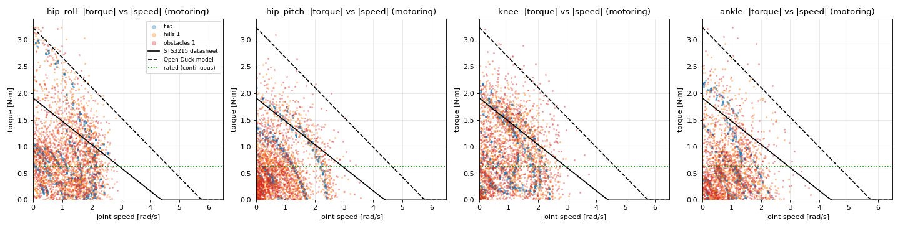

*점 = 걸으면서 쓴 토크와 관절 속도. 실선(데이터시트)·점선(실측 모델) 바깥의 점은 실물 서보가 낼 수 없는 토크입니다.*

이 점검에서 나온 것을 학습 옵션으로 반영합니다 (자세한 내용과 실험 결과는 [docs/09 §8~9](docs/09_open_source_robot.md)):

| 옵션 | 뜻 |
|---|---|
| `--servo open_duck` | 실측 서보 모델: 빨리 돌수록 토크가 줄어듦 |
| `--friction 0.4 1.0` | 바닥 마찰을 환경마다 무작위로 (미끄러운 바닥 대비) |
| `--terrain-difficulty 0.8 2.0` | 시험만큼 험한 지형에서 연습 |
| `--reward servo_overload=-1` | 서보 데이터시트 한계를 넘는 토크에 감점 |
| `--push 0.5 2` | 2초마다 몸통을 무작위로 밀기 (부딪힘 대비) |
| `--deployable-obs` | 실물에서 잴 수 있는 센서 값만 쓰기 + 센서 잡음 (실물 오리에는 몸통 속도·높이 센서가 없음) |
| `--privileged-critic` | 비대칭 actor-critic: 학습 중 점수만 매기는 critic은 전체 정보를 봄 (실물에 올리는 정책은 그대로) |
| `--domain-rand` | 몸통 질량·모터 세기·무게중심·제어 지연(0~40 ms)을 환경마다 무작위로 (실물이 시뮬레이션과 조금 달라도 걷게) |
| `--obs-history 3` | 지난 3스텝의 관측도 정책에 줌 (지난 움직임에서 실물 차이를 짐작하게) |

### 15단계. 학습 뒤 자동 평가, 그리고 자율 학습

걷기 학습(10단계~)이 끝나면 **자동으로 평가**하고 보고서를 만듭니다 (약 5분, 끄려면 `--no-eval`).
이어서 학습했으면(`--init-from`) 시작 정책과 같은 조건에서 비교합니다.

| 평가 | 내용 |
|---|---|
| 지형 | 지형 5종 × 험한 정도 1.5, 2.0 × 마찰 1.0, 0.5, 각 10번 → **보행 점수** = 울퉁불퉁한 지형 160번 중 10초 버틴 비율 |
| 밀기 | 평지에서 2초마다 0.3·0.4 m/s로 밀기, 각 10번 |
| 모델 오차 | 무게·모터 세기·무게중심·제어 지연을 일부러 바꾼 로봇으로 섞인 코스 걷기 |
| 서보 | 관절 토크가 서보 데이터시트 한계 밖인 시간 |
| 걸음 | 속도, 발 들기, 좌우 걸음 길이, **절뚝임 점수**, 연속 사진·그래프·영상 |
| 판정 | 합격 여부, 차이가 **우연보다 큰지**(통계), 지금까지 가장 잘 걷는 정책(**챔피언**)을 바꿀지 |

보고서 예 (`<실행 폴더>/eval/report.md`, TensorBoard의 TEXT 탭에도):

```
- 보행 점수 90.0 (울퉁불퉁한 지형 160번 중 10초 버팀 비율) — 합격
- 🏆 챔피언 갱신 — 보행 점수는 우연 범위 안에서 같고 밀기 시험이 우연보다 크게 좋음 (14 → 20 / 20)
- 밀기 버티기 (평지, 2초마다 무작위 방향, 10번 중): 0.3 m/s 10 → 10, 0.4 m/s 4 → 10
- 평지 다리 토크 평균 RMS 0.54 → 0.53 N·m (-2 %), 데이터시트 한계 밖 평균 0.1 → 0.0 %
```

```bash
python learning/evaluate_walk.py --params output/learning/<실행>/params.pkl            # 따로 실행 (기준 = 시작 정책)
python learning/evaluate_walk.py --params A.pkl --baseline B.pkl                       # 두 정책 비교
python learning/evaluate_walk.py --params <정책.pkl> --quick                            # 빠르게 (약 40초)
```

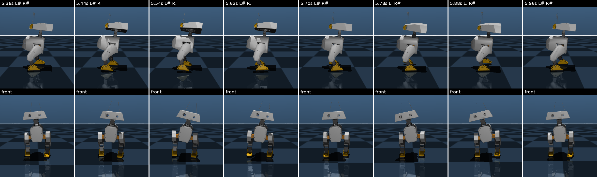

*지금의 실물 관측 챔피언 (2026-10-12, 실물에 있는 센서만 사용): 험한 지형 160번 중 141번 버팀, 밀기·무게·모터·지연·조립 오차 시험 대부분 통과, 절뚝임 3.7 %.*

**자율 학습**: 이 평가를 바탕으로 Claude(AI)가 다음 실험을 스스로 골라 학습 → 평가 → 판단을 반복합니다.

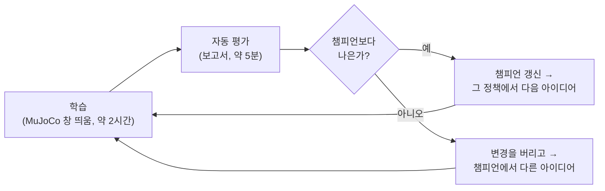

판단 규칙, 아이디어 목록, 실험마다의 기록과 배운 것 → **[docs/10 자율 학습](docs/10_auto_research.md)**

### 16단계. 명령 따라 걷기 — 방향키로 오리 조종하기

실물로 쓰려면 "더 빨리·천천히·뒤로·옆으로·돌아"를 시킬 수 있어야 합니다. 이 능력을 자율 학습(4·5차)으로 더한 정책을 직접 조종해 봅니다.

```bash
source scripts/activate_gpu.sh
python learning/play_walk.py --view --params learning/pretrained/duck_cmd_policy.pkl
```

| 키 | 동작 |
|---|---|
| ↑ / ↓ | 앞뒤 속도 +0.05 / −0.05 m/s |
| ← / → | 왼쪽 / 오른쪽으로 돌기 (±0.1 rad/s씩) |
| PageUp / PageDown | 왼쪽 / 오른쪽 옆걸음 (±0.04 m/s씩) |
| Backspace / Home | 멈춤 (제자리 걸음) / 기본 (앞 0.15) |

✅ 확인: 화면 위쪽에 지금 명령이 보이고, 키를 누를 때마다 오리가 그쪽으로 걸으면 성공 (에피소드 60초)

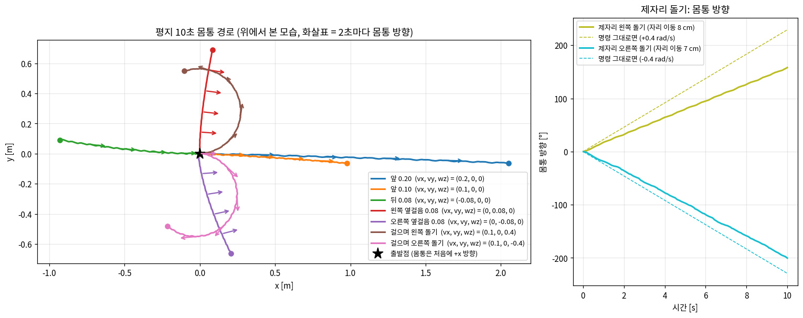

*명령마다 평지에서 10초 걸은 경로 (위에서 본 모습, 5차 R4 정책). 앞·뒤·옆·돌기를 모두 따라가고 앞 0.20은 2 m에 6 cm만 휩니다.
제자리 돌기는 자리를 거의 벗어나지 않지만 평지에서는 명령(0.4 rad/s)보다 조금 느립니다.*

> 💡 `learning/pretrained/duck_cmd_policy.pkl`은 자율 학습으로 만든 정책을 저장소에 넣어 둔 것입니다 (오리 로봇 파일은 11단계에서 받기).
> 직접 만들려면 docs/10 §9(4차)·§10(5차)의 명령으로 차례로 이어서 학습하세요 (`--cmd-vx/--cmd-vy/--cmd-wz` 명령 범위, `--init-from` 이전 정책, 모두 약 26시간).
> 학습한 범위는 앞 −0.20~0.40, 옆 ±0.15 m/s, 회전 ±0.5 rad/s이지만, 안정적으로 따르는 것은 앞 0.35 · 뒤 0.08 · 옆 0.08까지입니다.

명령 시험(명령 11가지 × 10번, **명령 점수**)은 15단계의 자동 평가에 함께 들어 있습니다. 바꾼 것·결과·실물 주의점 →
**[docs/09 §10](docs/09_open_source_robot.md)**, 실험 기록 → [docs/10 §9](docs/10_auto_research.md)

### 17단계. ROS2로 정책 돌리기 — 실물과 같은 구조로 조종 (sim-to-sim)

16단계는 정책을 파이썬에서 직접 불렀습니다. 실물 로봇에서는 센서 → 정책 → 서보가 **ROS2 토픽**으로 오갑니다.
같은 구조로 MuJoCo 오리를 조종해, 학습과 다른 시뮬레이터 + 메시지 지연에서도 걷는지 확인합니다 (GPU 없어도 됨).

```bash
bash scripts/build_ros.sh && source scripts/activate.sh          # 새 노드(policy_node, key_teleop)를 위해 다시 빌드
ros2 launch giga_sim_ros duck.launch.py                          # 오리 + 정책 (terrain:=mixed 이면 험지)
```

다른 터미널에서 키보드로 조종 — **이 터미널을 클릭해 둔 채로** 키를 누릅니다 (MuJoCo 창이 아니라):

```bash
source scripts/activate.sh
ros2 run giga_sim_ros key_teleop
```

16단계와 같은 키입니다: ↑↓ 앞뒤 속도, ←→ 돌기, PageUp/PageDown 옆걸음, Space 멈춤, Home 기본(앞 0.15), r 처음 자리로.
MuJoCo 창에서는 숫자 키로 보기를 바꿉니다: `6` 따라가기 · `7` 위에서 · `8` 옆에서 · `9` 지형 전체.

**핸드폰으로 조종**: `ros2 launch giga_sim_ros duck.launch.py phone:=true`로 실행하고, 출력에 나오는 주소(예: `http://192.168.0.14:8080`)를
같은 Wi-Fi의 핸드폰 브라우저로 열면 두 스틱 조이스틱이 나옵니다 (앱 설치 없음, 가로로 들기 권장).

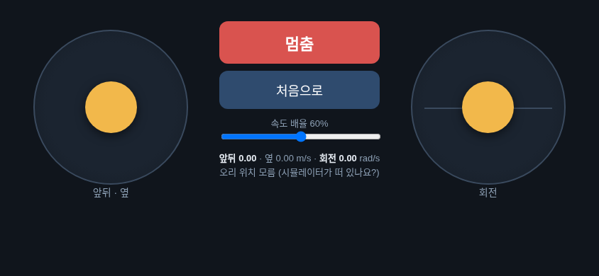

**직접 만든 험지에서**: `terrain:=playground`(계단·경사로·디딤돌·자갈밭이 둘러싼 놀이터) 같은 예시 코스, 또는 직접 쓴 코스 파일(YAML)·
그림판으로 그린 흑백 그림(PNG)을 `terrain:=내코스.yaml`로 띄웁니다. 만드는 법 → [docs/11 §3](docs/11_ros_duck_teleop.md)

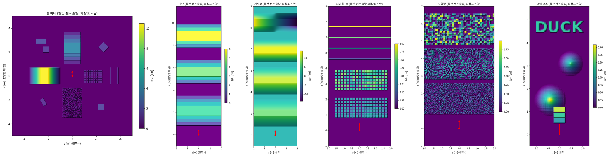

✅ 확인: 키를 누를 때마다 터미널에 `명령  앞뒤 +0.05 m/s …`가 바뀌고, MuJoCo 창의 오리가 그쪽으로 걸으면 성공
(카메라가 오리를 따라가므로 바닥 격자가 흘러가는 것으로 보입니다). 넘어지면 1초 뒤 처음 자리로 돌아옵니다.

> ROS 표준 조종기 `teleop_twist_keyboard`는 글자 키(`i`, `j`…)를 쓰는데, **한글 입력 상태면 아무 반응이 없습니다** (`ㅑ`가 들어가 '멈춤').
> 방향키를 쓰는 `key_teleop`은 한/영 상태와 상관없이 동작합니다.


명령 11가지를 ROS로 시험해도 모두 성공했습니다 (ROS 없이 돌릴 때와 속도 차이 0.01 m/s 안). 구조·결과·다음 계획
(핸드폰 조이스틱, 직접 만드는 험지, 조종 기록으로 다시 학습) → **[docs/11](docs/11_ros_duck_teleop.md)**

---

### 막혔을 때

| 증상 | 해결 |
|---|---|
| 줄 앞에 `(base)` 가 보이고 3·4단계에서 conda 경고 | `conda deactivate` 후 다시 |
| `No module named 'mujoco'` | 4단계(`source scripts/activate.sh`)를 안 한 터미널입니다 |
| `ros2: command not found` | 2단계를 안 했거나, 4단계를 안 한 터미널입니다 |
| `Package 'giga_sim_ros' not found` | 6단계를 하고 `source scripts/activate.sh` 를 다시 |
| 노드 실행 시 `No module named 'mujoco'` | `colcon build` 를 직접 썼음 → `bash scripts/build_ros.sh` |
| 다른 터미널에서 `ros2 topic list` 에 토픽이 안 보임 | 그 터미널에서도 4단계를 해야 합니다 (같은 `ROS_DOMAIN_ID=27` 이 되도록) |
| 창이 안 뜸 (원격 접속 등 화면 없는 환경) | 튜토리얼은 `--headless`, ROS2는 `viewer:=false rviz:=false` 를 붙여 실행 |
| GPU 환경(`activate_gpu.sh`)을 켠 터미널에서 4단계를 했더니 `ros2: command not found` | 2026-10-11 이전 `activate.sh`의 문제입니다 → `git pull`. 또는 새 터미널에서 4단계 |
| 학습 시작 후 몇 분간 출력이 없음 | 정상입니다. GPU용 코드 컴파일(약 3~4분) |
| 스텝 수를 다 채웠는데 안 끝나는 것 같음 | 학습 뒤 **자동 평가**(약 5분)가 돌고 있습니다. 출력에 `자동 평가 시작`이 보이면 정상 |
| 학습이 이상하게 느림 | `nvidia-smi`로 다른 프로그램이 GPU를 쓰는지 확인. `--watch` 창은 학습을 약 2배 느리게 함 |
| 그 밖의 문제 | `python scripts/check_env.py` 출력을 확인 → [docs/01 문제 해결](docs/01_environment.md), GPU 학습은 [docs/08 §7](docs/08_gpu_walking.md) |

### 다음에 읽을 것

| 문서 | 내용 |
|---|---|
| [tutorials/README.md](tutorials/README.md) | MuJoCo 튜토리얼 t01~t07 (순서대로, 과제 포함) |
| [docs/06_ros2_hands_on.md](docs/06_ros2_hands_on.md) | ROS2 실행 가이드: 명령별로 무슨 일이 일어나는지 |
| [docs/07_learning.md](docs/07_learning.md) | 강화학습 첫 예제: 개념, 실행, 결과 해석, CPU vs GPU |
| [docs/08_gpu_walking.md](docs/08_gpu_walking.md) | GPU 보행 학습: MJX + Brax PPO, 보상 설계, 걸음 분석·다듬기, 자동 평가 |
| [docs/09_open_source_robot.md](docs/09_open_source_robot.md) | 오픈소스 오리 로봇: 불러오기, 걷기, 지형, 실물 기준 점검(동역학 한계·서보), 실험 기록 |
| [docs/10_auto_research.md](docs/10_auto_research.md) | 자율 학습: 보행 점수·챔피언, 판단 규칙, 실험 기록과 배운 것 |
| [docs/11_ros_duck_teleop.md](docs/11_ros_duck_teleop.md) | 학습한 오리를 ROS2로 조종 (sim-to-sim): 정책 노드, 조종, 결과 |
| [docs/00_roadmap.md](docs/00_roadmap.md) | 전체 계획과 현재 위치 |
| [docs/02](docs/02_mujoco_concepts.md) · [03](docs/03_urdf_and_mujoco.md) · [04](docs/04_simple_biped_spec.md) | MuJoCo 개념, URDF 변환 규칙, 로봇 사양 |

---

## 지금 어디까지 왔나 (2026-10-15)

- **명령 따라 걷기 챔피언** (실물 센서만 사용, 16·17단계, 5차 R4): 명령 11가지 × 10번 중 108번 성공 (명령 점수 98.2) — 앞 0.05~0.35 m/s
  (4차보다 1.45배 빠름), 뒤 0.08, 옆 ±0.08, 제자리·걸으며 돌기 ±0.4 rad/s. 험한 지형 160번 중 145번 버팀, 밀기 20 / 20, 모델 오차 29 / 30,
  머리 좌우 흔들림 12 → 8.6 cm (`output/learning/champion_open_duck_mini_deployable_cmd.json`).
- **실물 관측 챔피언** (명령 없이 앞 0.15만, 비대칭 actor-critic + 실물 오차 무작위화 + 관측 기록으로 학습):
  험한 지형 160번 중 141번 버팀, 0.4 m/s 밀기 10번 모두 버팀, **무게·모터가 틀리고 40 ms 늦은 로봇으로도 10번 중 9번**
  (무작위화 전 3번), 관절 영점·IMU 조립 오차 + 20 ms 지연에서 9번 (`output/learning/champion_open_duck_mini_deployable.json`).
- **오리 로봇 챔피언** (시뮬레이션 전용): 험한 지형 160번 중 144번 버팀, 0.4 m/s 밀기 10번 모두 버팀, 서보 데이터시트 한계 밖 0 %
  (`output/learning/champion_open_duck_mini.json`). 시뮬레이션에만 있는 센서 값(몸통 속도·높이)을 써서 실물에는 못 올립니다.
- **ROS2로 조종** (17단계): 학습한 정책을 센서 토픽 → 정책 노드 → 관절 명령으로 돌려도 명령 11가지 모두 성공 (sim-to-sim).
- **다음**: 핸드폰 조이스틱, 직접 만드는 험지, 조종 기록으로 다시 학습 ([docs/11](docs/11_ros_duck_teleop.md)).
  실물에서는 hip_roll 서보 부하(정격의 1.5배)와 온도를 꼭 확인.
- **가장 효과가 컸던 것**: 시험만큼 험한 지형에서 연습하기 (보행 점수 77.5 → 86.9), 서보 한계 초과 감점 (한계 밖 5.6 → 0.1 %),
  명령 범위를 시험값보다 넓게 잡기 (명령 점수 48.5 → 78.8).

<details>
<summary><b>폴더 구조</b> (펼치기)</summary>

```
Giga/                             (clone한 폴더 이름. 로컬에서 다른 이름이어도 무관)
├── README.md                     ← 지금 이 파일 (시작점)
├── requirements.txt              ← pip 의존성 (mujoco==3.15.0, numpy<2, -e .)
├── requirements-learning.txt     ← (선택) 강화학습 패키지: stable-baselines3, gymnasium, tensorboard (torch는 setup_learning.sh가)
├── requirements-gpu.txt          ← (선택) GPU 학습 환경(.venv-mjx): jax[cuda12], mujoco-mjx, brax
├── pyproject.toml                ← biped_sim 패키지 정의 (pip install -e . 로 어디서든 import 가능)
│
├── scripts/                      ── 환경/도구
│   ├── install_system_deps.sh    ← [1회, sudo] ROS2 Humble 등 apt 패키지 설치 (--dry-run으로 미리 보기)
│   ├── setup_env.sh              ← [1회] .venv 생성 + 설치 + 점검
│   ├── activate.sh               ← [매 터미널] source: ROS2 Humble + .venv + ros2_ws + ROS_DOMAIN_ID=27
│   ├── setup_learning.sh         ← [선택, 1회] PyTorch(CPU판, --gpu로 GPU판) + 강화학습 패키지 설치
│   ├── setup_gpu_learning.sh     ← [선택, 1회] GPU 학습 환경 .venv-mjx 설치 (JAX, MJX, Brax)
│   ├── activate_gpu.sh           ← [GPU 학습 터미널마다] source: .venv-mjx 켜기
│   ├── check_env.py              ← 환경 진단 (Python/numpy/mujoco/ROS2/GL)
│   ├── build_ros.sh              ← ros2_ws 빌드 (venv의 python -m colcon build — 그냥 colcon build 금지)
│   ├── get_open_duck.sh          ← [선택, 1회] 오픈소스 오리 로봇 Open Duck Mini 내려받기 (고정 커밋, docs/09)
│   └── inertia_calc.py           ← box/cylinder/sphere 관성 → URDF <inertia> 한 줄
│
├── docs/                         ── 학습 문서 (번호 순서대로)
│   ├── 00_roadmap.md             ← 전체 계획 Phase 0~8, 현재 위치
│   ├── 01_environment.md         ← 왜 venv인가, 왜 numpy<2인가, 문제 해결
│   ├── 02_mujoco_concepts.md     ← MjModel/MjData, nq≠nv, 좌표·쿼터니언 규약, 접촉, 적분기
│   ├── 03_urdf_and_mujoco.md     ← URDF 문법 + MuJoCo 변환 규칙(실측) + 실제 로봇 체크리스트
│   ├── 04_simple_biped_spec.md   ← 2족 모델 사양서 (치수·질량·관절·부호·게인 근거)
│   ├── 05_ros2_bridge_plan.md    ← ROS2 연동 단계별 실행 계획 (사전 검증 결과, 인터페이스 명세, 결정 사항, 진행 상태)
│   ├── 06_ros2_hands_on.md       ← ROS2 실행 가이드: 명령별로 일어나는 일 + 터미널 실습
│   ├── 07_learning.md            ← 강화학습 첫 예제: 밀려도 넘어지지 않기 (PPO), TensorBoard
│   ├── 08_gpu_walking.md         ← GPU 보행 학습: MuJoCo MJX + Brax PPO, 보상 설계, 걸음 분석·다듬기, 자동 평가
│   ├── 09_open_source_robot.md   ← 오픈소스 로봇(오리): 불러오기, 걷기, 지형, 동역학 한계, 실물 기준 학습 기록
│   ├── 10_auto_research.md       ← 자율 학습 규칙과 실험 기록 (보행 점수, 챔피언)
│   ├── 11_ros_duck_teleop.md     ← 학습한 오리를 ROS2로 조종 (sim-to-sim)
│   └── images/                   ← 문서의 "이렇게 보이면 성공" 그림
│
├── models/                       ── 로봇/장면 모델 (원본)
│   ├── mjcf/falling_box.xml      ← MJCF Hello World (t01, t02)
│   ├── urdf/pendulum/pendulum.urdf ← 최소 URDF: 링크 2 + 관절 1 (t03)
│   │                               (2족 로봇 URDF는 ros2_ws/src/giga_description/urdf/ 에 있음)
│   ├── courses/                  ← 직접 만드는 험지 예시: stairs, ramp, stones, gravel, playground, drawing (docs/11 §3)
│   └── third_party/              ← 외부 오픈소스 로봇 (내려받아 채움, git 제외. README.md에 출처·라이선스)
│
├── biped_sim/                    ── 시뮬레이터 코어 (Python 패키지)
│   ├── __init__.py               ← 공개 API 모음
│   ├── paths.py                  ← 파일 경로 상수 (실행 위치와 무관하게 동작)
│   ├── builder.py                ← URDF → MuJoCo 모델 (freejoint·모터·IMU·바닥·충돌제외·키프레임·지형)
│   ├── robot.py                  ← RobotInterface: 관절 '이름' 기반 상태 읽기/토크 쓰기 (ROS2 JointState 대응)
│   ├── controllers.py            ← JointPDController (τ = Kp·e + Kd·ė + τ_ff, 토크 포화)
│   ├── robot_configs.py          ← 로봇별 설정 (URDF 경로, home 자세, 게인, 발 링크): SIMPLE_BIPED, OPEN_DUCK_MINI
│   ├── runner.py                 ← simulate() 루프 (뷰어/헤드리스), passive_viewer(안전한 뷰어 종료), 스냅샷, 카메라
│   ├── utils.py                  ← 쿼터니언 변환(MuJoCo↔ROS), 지면 높이 계산
│   ├── terrain.py                ← 울퉁불퉁한 지형(높이맵): 언덕·불규칙한 경사로·장애물·학습용 넓은 지형
│   ├── policy.py                 ← numpy만으로 학습한 정책 돌리기 (ROS2 policy_node, 실물 보드)
│   ├── course.py                 ← 직접 만드는 험지: 코스 파일(YAML)·흑백 그림(PNG) → 높이맵, 미리 보기
│   └── envs/                     ← 강화학습 환경
│       ├── balance.py            ←   밀기 버티기 (Gymnasium, CPU) + 평가 함수
│       ├── walk_spec.py          ←   보행 과제 설정·서보 모델·학습과 같은 모델·관측 계산 (jax 없이: ROS2 노드도 씀)
│       └── walk_mjx.py           ←   보행 (Brax, GPU MJX): 보상, 마찰·밀기·실물 오차 무작위 — .venv-mjx에서만
│
├── tutorials/                    ── 학생용 실습 (순서대로)
│   ├── README.md                 ← 각 튜토리얼의 관찰 포인트 + 과제
│   ├── t01_hello_mujoco.py       ← 시뮬레이션 루프, 뷰어
│   ├── t02_model_and_data.py     ← nq≠nv, mj_forward vs mj_step, 쿼터니언, 접촉력
│   ├── t03_urdf_pendulum.py      ← URDF 로드 → 검증 실패 → 진단 → 수정 → 재검증
│   ├── t04_biped_inspect.py      ← 2족 URDF 해부, 인덱스 표, MJCF 내보내기
│   ├── t05_biped_hanging_pd.py   ← 매단 로봇 관절 PD 궤적 추종 (게인/피드포워드 비교)
│   ├── t06_biped_stand.py        ← 바닥에 세우기, 접촉력=무게 검증, 밀기 실험
│   └── t07_open_duck.py          ← 남이 만든 오픈소스 로봇(오리) 불러오기: 문제 확인 → 보완 → 서 있기
│
├── tests/                        ── 회귀 테스트 (pytest)
│   ├── test_simulator.py         ← URDF 변환 동작, 빌더, 진자 주기, 서 있기, 접촉력=무게
│   ├── test_tutorials_and_ros.py ← 튜토리얼 실행 + ROS2 robot_state_publisher URDF 파싱
│   ├── test_ros_sim_node.py      ← sim_node 통합: 주기, 명령, 초기화, IMU·TF, 정상 종료
│   ├── test_ros_launch.py        ← launch 통합: 앉았다 일어서기, 제어기 사망 시 감쇠 모드
│   ├── test_course.py            ← 직접 만드는 험지: 블록 높이, 그림 방향, 예시 코스
│   ├── test_ros_duck.py          ← 오리 + 학습한 정책을 ROS2로: /cmd_vel대로 걷기, /policy/reset (파일 있을 때만)
│   ├── test_learning.py          ← 학습 환경 규격, 기준선, 미리 학습된 모델 성능, 학습 스크립트
│   ├── test_open_duck.py         ← 오리 로봇: 빌더 보완, 바닥 1 mm 위 시작, 좌우 부호, 서 있기 (파일 있을 때만)
│   ├── test_terrain.py           ← 지형 높이 = MuJoCo 실제 표면(광선으로 확인), 바꿔 끼우기, 출발 자리
│   └── test_walk_mjx.py          ← GPU 보행 환경·관측 일치·서보 모델·자세·실물 관측·학습 화면·자동 평가 (.venv-mjx에서만)
│
├── learning/                     ── 강화학습 (CPU: docs/07, GPU 보행: docs/08~10)
│   ├── train_balance.py          ← PPO 학습 → output/learning/ (모델, 기록, 학습 곡선, 비교표)
│   ├── evaluate_balance.py       ← 비교표, MuJoCo 화면 재생 (--view, --baseline, --pretrained)
│   ├── train_walk_gpu.py         ← GPU 보행 학습 (Brax PPO), TensorBoard, 학습 화면(--watch), 끝나면 자동 평가
│   ├── play_walk.py              ← 보행 정책 학습 화면(--live)·재생(--view)
│   ├── walk_tools.py             ← 보행 공용 도구: 정책 불러오기, 재생기, 에피소드 기록, 걸음 수치
│   ├── gpu_env.py                ← GPU 학습 환경 확인 (다른 터미널에서 실행하면 .venv-mjx로 다시 실행)
│   ├── live_dashboard.py         ← MuJoCo 창 안의 학습 그래프·발 접촉 그래프 (Enter로 화면 전환)
│   ├── analyze_gait.py           ← 걸음 분석: 영상·연속 사진·그래프·절뚝임 점수, 체크포인트 비교(--run)
│   ├── terrain_trial.py          ← 울퉁불퉁한 지형 실험: MuJoCo 화면에서 에피소드마다 새 지형 (--headless는 통계)
│   ├── feasibility.py            ← 동역학 한계 계산(토크·턱·경사·속도·흔들림)과 학습한 걸음의 측정 비교 (docs/09 §8)
│   ├── evaluate_walk.py          ← 학습 뒤 자동 평가: 지형·밀기·서보·걸음, 보행 점수와 챔피언 (docs/08 §4.1, docs/10)
│   ├── export_policy.py          ← Brax 정책(.pkl) → numpy 정책(.npz): jax 없이 돌리기 (docs/11)
│   ├── course_trial.py           ← 직접 만든 코스를 정책으로 곧장 걸어 보기: 어디서 넘어지나 (docs/11 §3.1)
│   └── pretrained/               ← 미리 학습된 모델: balance_ppo.zip (밀기 버티기),
│                                    walk_policy.pkl/.json (다듬은 걸음, docs/08 §6)
│                                    duck_cmd_policy.pkl/.npz/.json (오리 명령 따라 걷기, 5차 R4 — docs/10 §10, .npz는 ROS2용)
│
├── ros2_ws/                      ── ROS2 colcon 워크스페이스 (build/ install/ log/는 git 제외)
│   └── src/
│       ├── giga_description/     ← ament_cmake: 로봇 "설명" 패키지
│       │   ├── urdf/simple_biped.urdf    ← 6-DoF 2족 로봇. ROS2·RViz·MuJoCo가 공유하는 단일 원본
│       │   ├── launch/display.launch.py  ← URDF를 RViz로 보기 (슬라이더, 물리 없음)
│       │   └── rviz/display.rviz, sim.rviz
│       └── giga_sim_ros/         ← ament_python: 시뮬레이터 ROS 어댑터
│           ├── giga_sim_ros/sim_node.py         ← MuJoCo를 감싼 ROS2 노드 = "가짜 로봇 하드웨어"
│           ├── giga_sim_ros/demo_controller.py  ← 토픽만으로 로봇 조종 (stand / squat)
│           ├── giga_sim_ros/policy_node.py      ← 학습한 보행 정책: IMU·관절 + /cmd_vel → 관절 목표 50 Hz
│           ├── giga_sim_ros/key_teleop.py       ← 터미널 방향키 → /cmd_vel (한글 입력 상태에서도)
│           ├── giga_sim_ros/phone_joystick.py   ← 핸드폰 브라우저 조이스틱 → /cmd_vel (같은 Wi-Fi)
│           ├── giga_sim_ros/shutdown.py         ← Ctrl+C·SIGTERM 안전 종료 처리
│           ├── launch/sim.launch.py             ← sim_node + robot_state_publisher + RViz + 제어기
│           ├── launch/duck.launch.py            ← 오리(sim_node) + policy_node (docs/11)
│           └── package.xml, setup.py, setup.cfg, resource/
│
├── output/                       ── 생성물 (git 제외): 학습 결과, 평가 보고서, 그래프, 스냅샷
├── .venv/                        ── 가상환경 (git 제외, setup_env.sh가 생성)
└── .venv-mjx/                    ── (선택) GPU 학습 가상환경 (git 제외, setup_gpu_learning.sh가 생성)
```

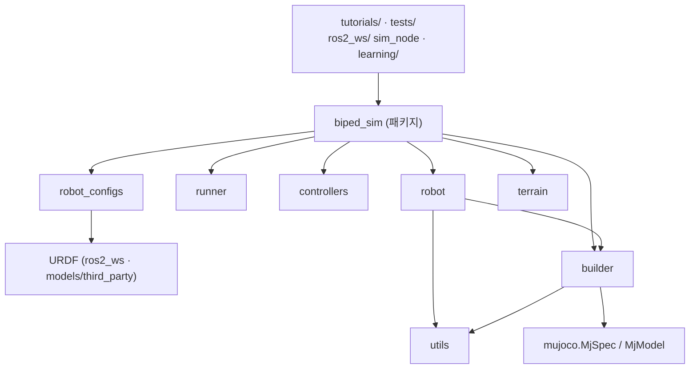

</details>

<details>
<summary><b>설계 원칙</b> (펼치기)</summary>

1. **URDF가 단일 원본**: 로봇 기구학/관성은 URDF 한 곳에서만 정의하고 ROS2와 공유합니다.
   시뮬레이션 전용 요소(바닥, 모터, IMU, freejoint 등)는 `biped_sim/builder.py`가 덧붙입니다. 받은 오픈소스 URDF도 고치지 않습니다.
2. **이름 기반 접근**: 배열 인덱스 대신 관절 이름으로 다룹니다 (`RobotInterface`). ROS2 `JointState`와 1:1.
3. **토크 모터 + 외부 PD**: MuJoCo의 position 액추에이터 대신, 실제 모터 드라이버처럼 PD를 직접 계산해 토크로 넣습니다.
4. **숫자로 검증**: 진자 주기 vs 이론, 접촉력 합 vs 무게, 지형 높이 vs 광선 측정 등 해석해와 비교하고, 그 결과를 테스트로 고정합니다.
5. **예전 결과를 깨지 않기**: 학습 설정(서보 모델, 자세, 관측 등)은 실행마다 `config.json`에 저장되고, 재생·분석은 그 설정을 그대로 씁니다.

</details>

<details>
<summary><b>지금까지 실험으로 확인한 중요한 사실</b> (펼치기)</summary>

| 사실 | 확인한 곳 |
|---|---|
| URDF를 그대로 MuJoCo에 넣으면 루트 링크가 world에 병합되고 visual·액추에이터가 사라진다 | t03, t04, `test_raw_urdf_import_behavior` |
| 병합된/고정된 몸통은 부모-자식 충돌 필터가 안 먹혀 **에러 없이 결과가 틀린다** (진자 주기 59% 오차) | t03, `test_fixed_base_has_no_spurious_self_contacts` |
| 서 있을 때 두 발 수직력 합 = 80.44 N = 8.2 kg × 9.81 | t06, `test_biped_stands_and_contact_force_equals_weight` |
| `package://` 메쉬 경로는 MuJoCo가 못 읽음 → `meshdir` + `strippath="true"`로 해결 | [docs/03](docs/03_urdf_and_mujoco.md), t07 |
| `mujoco.viewer.launch_passive`를 그대로 쓰면 종료 시 세그폴트/X 에러/멈춤 → `biped_sim.passive_viewer`로 해결 | [docs/05 §2](docs/05_ros2_bridge_plan.md) |
| ROS2 노드는 venv의 `python -m colcon build`로 빌드해야 MuJoCo를 쓸 수 있음 | `scripts/build_ros.sh` |
| Python ROS2 노드로 500 Hz 시뮬레이션 + 발행 가능 (제어 왕복 지연 중앙값 0.77 ms) | [docs/05 §2](docs/05_ros2_bridge_plan.md), `test_ros_sim_node.py` |
| 걸음 보상에 박자·대칭이 없으면 깡충 뛰거나 절뚝이며 걷는다 (절뚝임 40 % → 고친 뒤 1.8 %) | [docs/08 §5~6](docs/08_gpu_walking.md) |
| MuJoCo는 높이맵 데이터를 0~1로 다시 늘인다 (그대로 넣으면 언덕이 2배 높아짐) | `biped_sim/terrain.py`, `test_terrain.py` |
| 오리 서보는 데이터시트 기준 정지 토크 1.91 N·m인데 시뮬레이션 기본값은 3.23 N·m, 속도에 따른 감소도 없었다 | [docs/09 §8](docs/09_open_source_robot.md) |
| 보상을 더하는 것보다 **시험만큼 험한 곳에서 연습**하는 것이 효과가 가장 컸다 (보행 점수 77.5 → 86.9) | [docs/10 §6](docs/10_auto_research.md) |
| 시뮬레이션에서만 아는 센서 값(몸통 속도·높이)을 가리면 잘 걷던 정책이 거의 멈춘다 (0.15 → 0.03 m/s) | [docs/09 §9.13](docs/09_open_source_robot.md) |
| ROS 타이머는 놓친 호출을 따라잡지 않는다: 화면 갱신이 5 ms씩 기다리면 시뮬레이션이 실제 시간의 0.7배로 느려짐 → 지난 시간만큼 물리 스텝 | [docs/11 §5](docs/11_ros_duck_teleop.md) |

</details>
